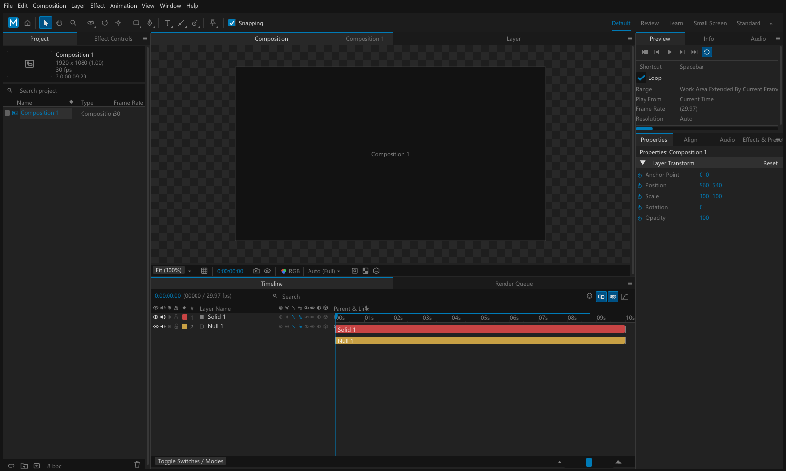

[](https://x.com/NorowaretaGemu)
[](https://opensource.org/licenses/MIT)

<br>
<div align="center">
  <a href="https://ko-fi.com/cursedentertainment">
    
  </a>
</div>
<br>
<div align="center">
  
  
  
</div>
<div align="center">
  
  
  
</div>
<br>

# Morpheus

**A motion graphics and compositing app for Windows (and Linux), written in C++.** Build a composition out of layers
(solids, shapes, text, footage, nested compositions), animate their properties with keyframes, stack effects on them,
and render the result. Part of **[Atelier](https://github.com/CursedPrograms/Atelier)**, Cursed Entertainment's
creative suite. Named after the Greek god of dreams who takes any shape.
**[Website](https://cursedprograms.github.io/Morpheus/)**



## What works

- **The skeleton (phase 1):** the full Atelier window with all seven panels (Project, Composition, Timeline,
  Effect Controls, Tools, Preview, Info), the menu bar, the splash screen, 12 languages and the dark theme.
- **The project model (phase 2):** compositions with size, frame rate and duration; exact integer media time
  (254,016,000,000 ticks/sec); layers (solid, shape, text, image, footage, nested composition, null, camera, light);
  full property tree with properties, groups, parameter UI, masks, and keyframe base (values, temporal/spatial
  interpolation, auto-Bezier, roving, time reverse). Saved and opened as `.morpheus` JSON.
- **Rendering (phase 3):** software rendering of compositions with animated transforms, opacity, masks, blending,
  and track mattes.
- **Timeline (phase 4 core):** frame-accurate playhead scrubbing, layer bars, move and in/out trim, foldable property
  rows, playback, and a bounded render-frame cache.
- **Timeline and keyframes (phases 4 and 5):** frame-accurate scrubbing, layer bars, move and in/out trim, layer
  reordering and marquee selection, property stopwatches, keyframes selected by Shift-click or marquee (with edge
  scrolling) and moved together, interpolation choices, and the Graph Editor with value and speed graphs and easing
  handles.
- **Shape layers (phase 6):** rectangles, ellipses, paths, fills, strokes and groups, edited in the Timeline's
  Contents, with the path operators Trim Paths, Repeater, Round Corners, Twist, Zig Zag, Pucker & Bloat and Offset
  Paths.

## Coming next

The last path operators (Wiggle, Merge Paths), text layers (phase 6), the rest of the Timeline's parity, effects (phase 7), masks and mattes (phase 8), footage in and the render
queue (phase 9), expressions and 3D cameras (phase 10).

## Minimum requirements

| | |
| --- | --- |
| **System** | Windows 10 or 11, 64-bit (Linux builds from source) |
| **Processor** | any 64-bit processor |
| **Memory** | 4 GB RAM |
| **Graphics** | any graphics card with OpenGL 3.3 (2010 or newer) |
| **Disk** | 20 MB |

## Build

Windows: Visual Studio 2022 (C++) and CMake, then `build.bat` (or `build.ps1`). It fetches Dear ImGui into
`external/` once and builds `build/Release/Morpheus.exe`.

Linux: `./build.sh` (needs cmake, a C++17 compiler and libsdl2-dev).

```
build.bat          # Windows
./build.sh         # Linux
```

After building, `install.bat` (or `install.ps1` / `install.sh`) puts the exe and its assets where the OS expects apps.

The code, in `src/`:
- `main.cpp`: SDL2, OpenGL 3 and Dear ImGui; the splash window; the main loop and `--capture` / `--render` hooks
- `app.cpp`: project management, menu actions, the scripted test hooks
- `panels.cpp`: the seven panels in the Atelier layout and look
- `project.cpp`: the project model; JSON save and load
- `render.cpp` / `raster.cpp`: software composition renderer and raster operations
- `timeline.cpp`: Timeline time mapping, snapping, and frame-accurate layer edits
- `time_.cpp`: exact integer media time arithmetic and timecode conversions
- `keyframe.cpp`: values, keyframing, temporal/spatial easing, orientation slerp
- `props.cpp`: hierarchical property tree, path resolution, and parameter descriptors
- `icons.cpp`: vector icons rendered in code on a 16x16 grid
- `splash.cpp`: the splash shown while loading and in Help > About
- `lang.cpp`: the 12 language packs (Language menu)
- `selftest.cpp`: automated self-test runner (all ported unit tests)

## Credits

The panel layout, project model, Timeline, keyframe behavior, and renderer are ported from
[EffectCraft](https://github.com/storytold/effectcraft) (MIT OR Apache-2.0).
Built with [Dear ImGui](https://github.com/ocornut/imgui), [SDL2](https://www.libsdl.org) and
[stb](https://github.com/nothings/stb).

<br>
<div align="center">
© Cursed Entertainment 2026
</div>
<br>
<div align="center">
<a href="https://cursed-entertainment.itch.io/" target="_blank">
    
</a>
</div>
